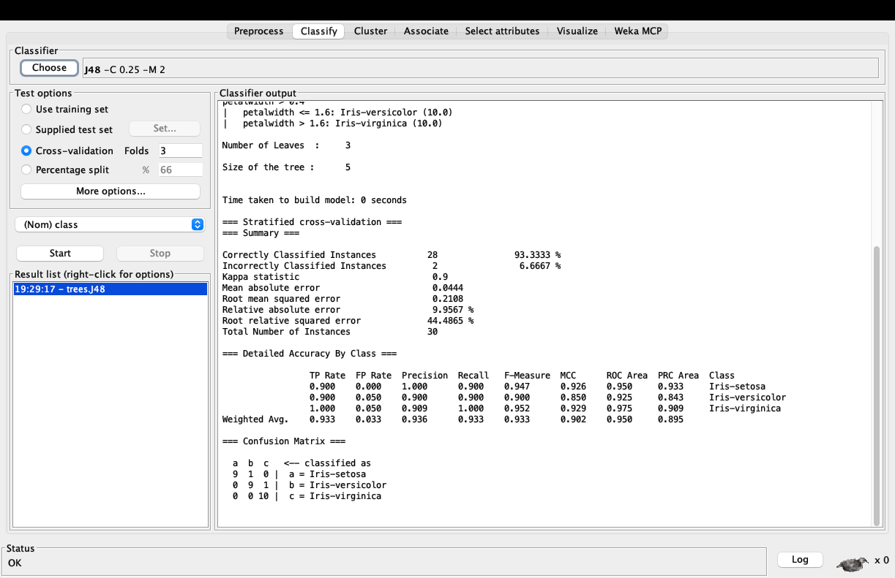

# Weka MCP

让支持 Model Context Protocol（MCP）的 Agent 使用 Weka 进行本地数据分析，并通过可选桥接操作正在运行的 Weka Explorer。

项目包含两个可以独立使用的模块：

- `weka-mcp-java` **1.6.0**：纯 Java STDIO 服务，提供 **43 个后台工具**，覆盖数据准备、画像、过滤、分类/回归、聚类、关联分析、属性选择、重复评估、AutoML、增量训练和模型互操作。
- `weka-gui-plugin` **0.8.0**：Weka Explorer 工作台与原生应用自动化桥接，额外提供 **21 个原生 Explorer 工具**。安装后，Agent 可以读取当前数据、执行预处理、启动原生训练/聚类/关联/属性选择任务并获取结果，还能打开和导出原生散点图。合计 **64 个工具**，而不是把同一个工具重复封装两次。

## 图文教程与实际截图

[查看安装、训练、Agent 桥接及原生散点图的完整图文教程](how-to-use/README.md)。教程包含六张真实运行截图，以及可复用的[宣传文案与配图建议](how-to-use/PROMOTION.md)。



## 环境与构建

需要 Java 17+ 和 Maven 3.9+。在仓库根目录依次构建：

```bash
cd weka-mcp-java
mvn -B -ntp clean verify
cd ../weka-gui-plugin
mvn -B -ntp clean verify
```

GUI 测试会启动真实 Explorer，需要图形桌面。Linux 无显示器环境使用 `xvfb-run -a mvn -B -ntp clean verify`，不能用 headless 模式替代 GUI 测试。

构建产物：

- 后台服务：`weka-mcp-java/target/weka-mcp-java-1.6.0.jar`
- Weka 安装包：`weka-gui-plugin/target/weka-mcp-gui-0.8.0.zip`

## 只使用后台服务

解压发布页中的 `weka-mcp-java-1.6.0.zip`，将 ARFF/CSV 放到部署目录的 `data/`，然后在 MCP 客户端配置启动脚本：

```json
{
  "mcpServers": {
    "weka": {
      "command": "/absolute/path/to/weka-mcp-java-1.6.0/start.sh"
    }
  }
}
```

Windows 使用同目录的 `start.bat`。不需要 Node.js，也不需要另行安装 Weka。详见[后台服务文档](weka-mcp-java/README.md)。

## 安装到 Weka 并启用原生桥接

1. 在 Weka stable 3.8.7 的包管理器中选择本地 `weka-mcp-gui-0.8.0.zip` 安装，然后重启 Explorer。Java 需要 17+。
2. 打开 **Weka MCP** 标签页，点击“启动 Agent 桥接”。该功能默认关闭，独立于后台服务启动按钮。
3. 按 [agent-config.example.json](weka-gui-plugin/agent-config.example.json) 配置 Agent，将命令路径改为实际 Weka 包目录中的 `bin/bridge-stdio.sh`；Windows 使用 `bin/bridge-stdio.bat`。
4. 先启用桥接，再让 Agent 连接。关闭 Explorer 或点击“停止 Agent 桥接”会关闭通道。

未设置 `WEKA_HOME` 时，包通常位于 `~/wekafiles/packages/wekaMcp/`。默认工作区是 `~/.weka-mcp-gui`，数据、实验和导出文件保存在这里。桥接只监听随机回环端口，使用随机令牌和单客户端连接；连接文件含访问令牌，不能分享或提交。这不是远程访问服务或安全沙箱。

详细安装、原生工具清单及调用顺序见[随包说明](weka-gui-plugin/src/main/package/README.md)。

## 验证范围与边界

- 本机已执行 macOS ARM64 的后台 STDIO 与真实 Explorer 测试；GitHub Actions 配置 Ubuntu、macOS、Windows 三平台构建。其他系统的实际结果见 Actions，不以设计推断代替实测。
- 仅支持文档列出的白名单算法、参数和原生散点图；不能操作任意 Weka/第三方 GUI 对话框，也不覆盖全部模型内部可视化。
- 后台工具不会自动改变 Explorer 原生页面；只有 `weka_explorer_*` 工具操作正在运行的 Explorer。不要在 Agent 执行原生任务时同时修改同一数据或模型。
- `dataset_version` 只比较当前会话中的对象身份，不是数据内容哈希，不能检测所有原地修改。
- Explorer 预处理默认在完整数据上拟合，不保证折内无泄漏。严格评估请使用后台服务的折内预处理。
- 导入 Weka 序列化模型仅限可信文件。自动搜索有预算和候选范围限制，超时属于软取消，不是进程级隔离。

## 许可证

项目源码采用 [GPL-3.0-or-later](LICENSE)。Weka 及其他第三方组件保留各自许可证，并非都采用 GPL。二进制分发的依赖、通知和对应源码获取方式见 [THIRD_PARTY_NOTICES.md](THIRD_PARTY_NOTICES.md)。这是按声明版本进行的依赖审查，不是正式法律审计。

详细测试记录：[后台服务](weka-mcp-java/VALIDATION_REPORT.md)、[原生桥接](weka-gui-plugin/RESULTS_VALIDATION.md)。
