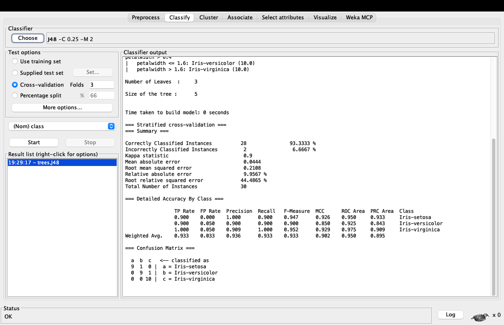
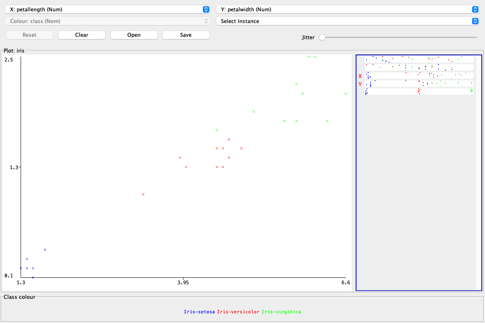

# Weka MCP 宣传文案与配图建议

以下文案按 **Weka MCP 0.8.0 / 后台服务 1.6.0** 的真实功能编写。可直接用于项目介绍、技术博客或社交媒体；转载图片时保留对应说明即可。

## 标题备选

1. **让 Agent 直接操作真正的 Weka Explorer**
2. **Weka MCP：从一句指令到可复现的数据分析**
3. **保留你熟悉的 Weka，让 AI 帮你完成分析**

一句话介绍：

> Weka 负责分析，Agent 负责驱动，你保留对数据和结果的控制。

## 长文版

数据分析常常需要在反复点击菜单和维护脚本之间切换。Weka MCP 将本地 Weka 接入 Model Context Protocol，让支持 MCP 的 Agent 在受控工具范围内完成数据准备、画像、训练、评估和模型导出。

它包含 **43 个后台工具**，覆盖分类/回归、聚类、关联分析、属性选择、重复交叉验证、自动搜索、增量训练以及模型互操作；另有 **21 个原生 Explorer 工具**，通过可选桥接读取当前数据、执行预处理、启动原生分类/聚类/关联/属性选择任务并获取结果，还能打开和导出原生散点图。

这意味着它不只是给 Weka 再套一个命令行外壳。Agent 可以真正驱动正在运行的 Weka Explorer，让算法、评估和图表继续由 Weka 自己完成。

你可以从一份 ARFF/CSV 开始，让 Agent 检查数据结构、训练 J48、读取交叉验证结果、比较属性贡献，再导出模型。支持 Weka GUI 模型包、原生模型以及部分 PMMLProducer 模型的导出；实验可以持久化并在后续会话恢复。

项目采用纯 Java 实现，Java 17+ 即可运行，不依赖 Node.js。Ubuntu、macOS、Windows 的 CI 均通过 **72 个测试**，包括真实 Explorer、STDIO 客户端和中文路径等场景。教程中的截图也来自真实 GUI 与 MCP 调用，而非概念设计图。

桥接默认关闭，启用后只监听随机回环端口，使用随机令牌和单客户端连接。分析在本地执行，不需要把数据集上传到另一个分析平台。你的 MCP 客户端或云端模型如何处理工具返回内容，则取决于你自己的 Agent 配置。

如果你希望保留 Weka 成熟的分析能力，同时减少重复操作，可以从安装包和六步图文教程开始：

- **项目地址**：https://github.com/Lawliet77-arch/weka-mcp
- **图文教程**：https://github.com/Lawliet77-arch/weka-mcp/tree/main/how-to-use

## 短文版

**让 Agent 直接操作真正的 Weka Explorer。**

Weka MCP 将本地 Weka 接入 MCP，提供 43 个后台工具和 21 个原生 Explorer 工具。它不仅能训练模型，还能读取当前数据、执行预处理、启动原生分类/聚类/关联/属性选择任务，并导出 Weka 原生散点图。

支持数据画像、交叉验证、自动搜索、增量训练、模型持久化与互操作。Java 17+ 即可运行，Ubuntu、macOS、Windows CI 均通过 72 个测试。

桥接默认关闭，使用随机回环端口、随机令牌和单客户端连接。不是替换 Weka，而是让 Agent 在受控范围内驱动你熟悉的 Weka。

项目与图文教程：https://github.com/Lawliet77-arch/weka-mcp/tree/main/how-to-use

#Weka #MCP #机器学习 #数据分析 #Java

## 海报/幻灯片要点

- **真实 Explorer 自动化**：不是另写一个结果面板，而是调用 Weka 原生任务与结果。
- **完整本地工作流**：数据准备、画像、训练、评估、属性选择、聚类、关联和导出。
- **43 + 21 个工具**：后台分析与原生 Explorer 操作分工明确。
- **模型互操作**：实验持久化、跨进程恢复、Weka GUI 模型包、可信模型导入及部分 PMML 导出。
- **跨平台验证**：Ubuntu、macOS、Windows 各 72 个测试通过。
- **可控的桥接**：默认关闭、随机回环端口、随机令牌、单客户端。

## 配图建议

- **主图**：`images/04-native-classifier.png`。标题可写“Agent 调用后，真实的 Weka 交叉验证结果”。
- **功能展示**：`images/06-native-scatter.png`。标题可写“直接打开并导出 Weka 原生散点图”。
- **教程首图**：`images/02-mcp-workbench.png`。用于说明后台 MCP 工作台，不要误称为原生 Classify 页面。
- **模型互操作**：`images/03-export-model.png`。用于说明 Weka GUI 兼容模型包，不要称为通用 PMML。
- **数据准备**：`images/01-preprocess.png`。示例为 30 条 Iris 样本。
- **属性分析**：`images/05-attribute-selection.png`。展示 GainRatio 排名，不要将排名解释为因果贡献。

## 发布时必须保留的事实边界

- 这 **64 个是工具，不是 64 种算法**。后台白名单包含 36 个分类器、18 个过滤器、6 个聚类器和 2 个关联算法；原生算法覆盖范围以随包文档为准。
- 不说“接管全部 Weka”“支持全部 GUI/模型可视化”“任意执行 Java 类”或“完全替代数据分析师”。原生散点图已覆盖，其他专用图和任意对话框未承诺。
- `dataset_version` 不是内容哈希；`COMPLETE` 不保证结果仍适用于当前数据。Explorer 全量预处理也不保证折内无泄漏。
- 本地计算不等于数据永不离开本机。Agent 或云端模型可能接收工具输出，应根据数据敏感程度选择部署方式。
- 截图来自 macOS 上的真实运行；三平台测试结论来自 GitHub Actions。图中 93.333% 是 30 条样本上的示例结果，不是通用准确率承诺。
- 仓库目前为**私有**。对外宣传前请先转为公开，并确认 Release 下载链接和教程可以访问。不要公开 `bridge.json`、访问令牌或真实私有数据。

[返回图文教程](README.md)
