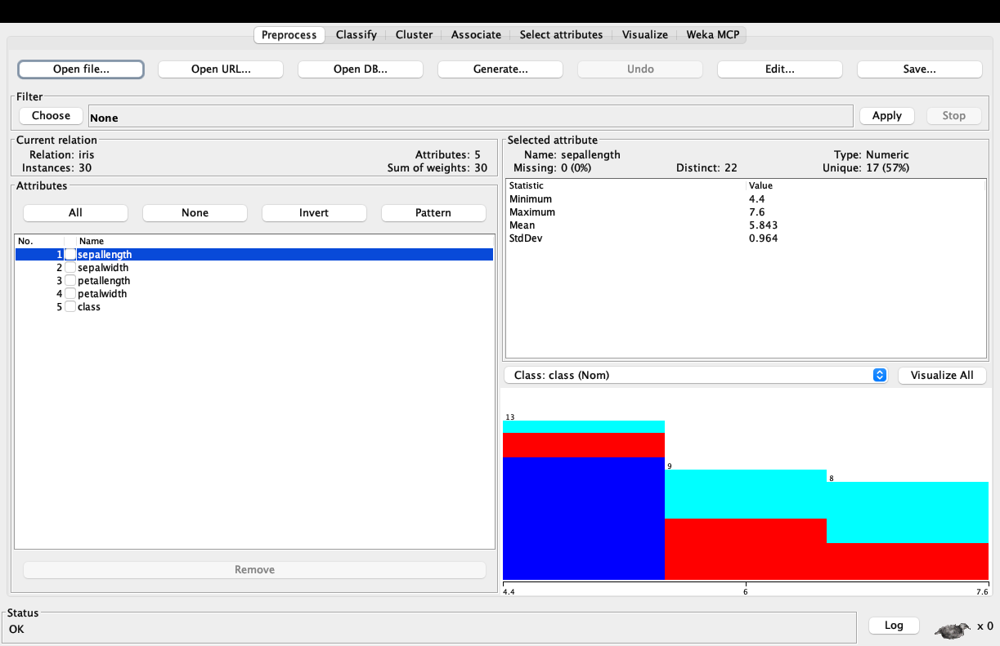
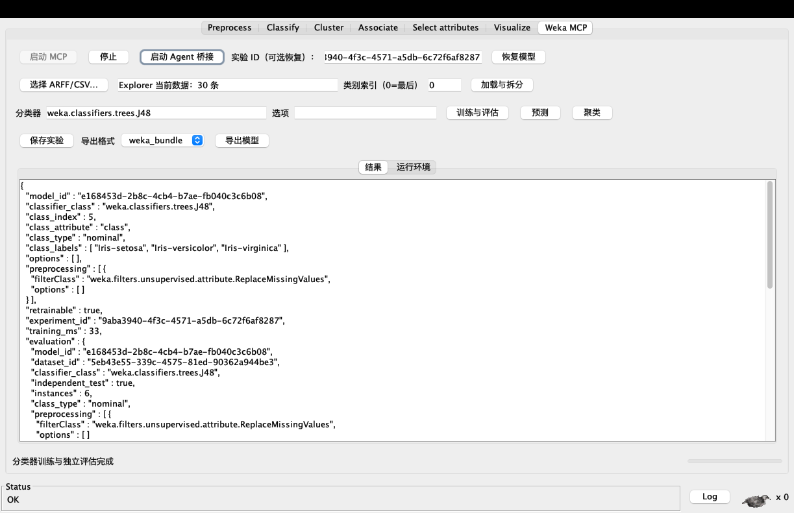
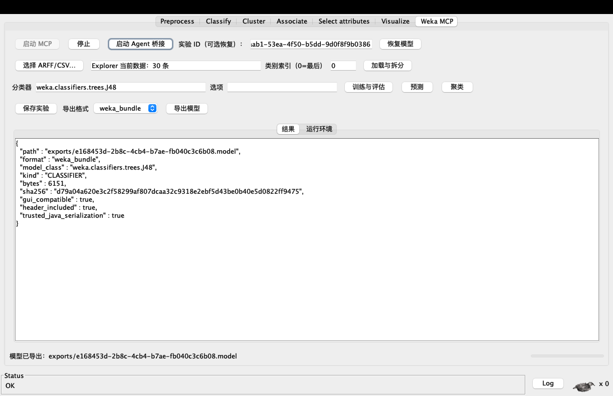
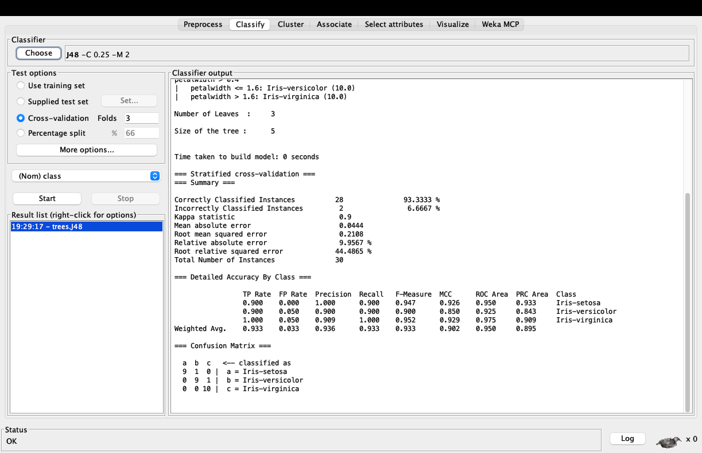
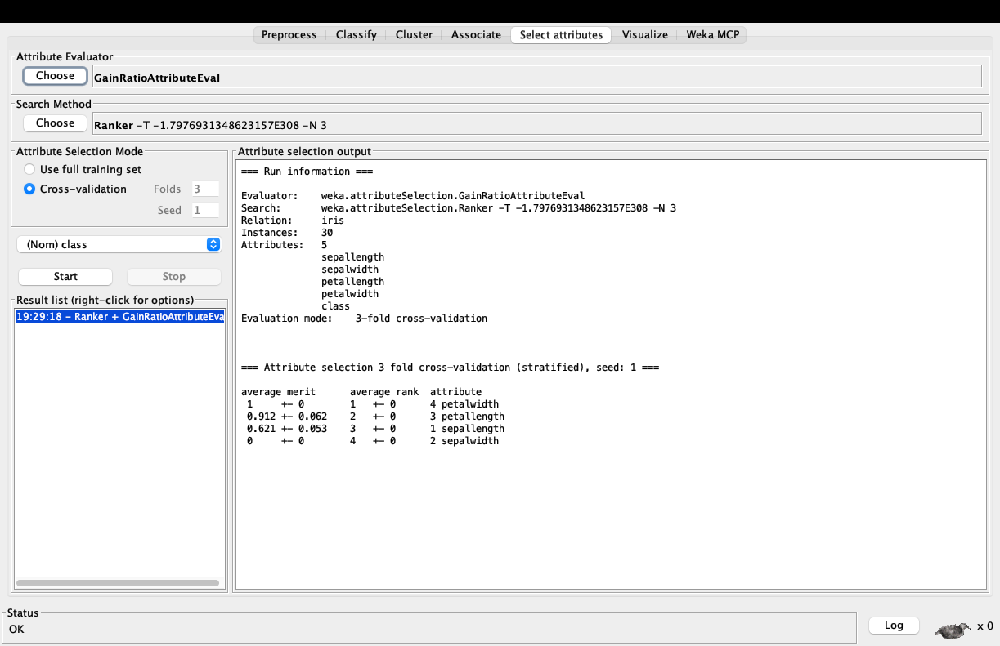
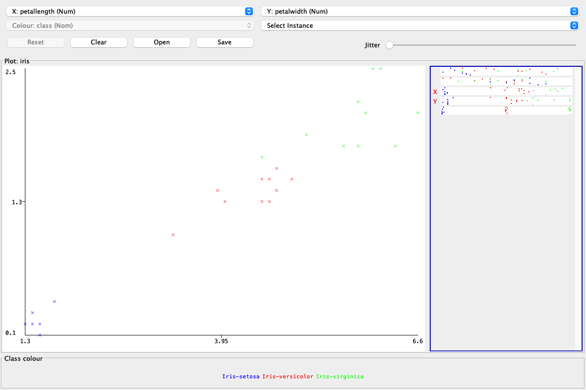

# Weka MCP 图文教程：让 Agent 操作真实的 Weka Explorer

本教程以 **Weka MCP GUI 0.8.0** 和后台服务 **1.6.0** 为例，演示从安装、数据加载、训练到 Agent 原生自动化的完整流程。

**关于截图**：六张图片均来自实际运行的 Weka Explorer。后台 GUI 操作使用真实 Swing 按钮，原生操作由外部 MCP 客户端通过 STDIO 桥接执行，不是手绘示意图。散点图由 `weka_explorer_capture_visualization` 返回的 PNG 解码保存。示例使用项目测试资源中的 **30 条 Iris 样本**，不是完整的 150 条 Iris 数据集；图中指标仅用于演示，不构成性能承诺。

## 1. 准备与安装

需要：

- Java 17 或更高版本。
- Weka stable 3.8.7（教程使用其 Explorer）。
- 发布附件 [`weka-mcp-gui-0.8.0.zip`](https://github.com/Lawliet77-arch/weka-mcp/releases/download/v0.8.0/weka-mcp-gui-0.8.0.zip)。

在 Weka 包管理器中选择本地 ZIP 安装，然后重启 Explorer。未设置 `WEKA_HOME` 时，包通常位于：

```text
~/wekafiles/packages/wekaMcp/
```

如果只想在没有图形界面的环境使用 43 个后台工具，可以改用独立服务包 `weka-mcp-java-1.6.0.zip`，不需要安装 Weka 或 Node.js。本教程后面的原生桥接需要真实 Explorer 和图形桌面。

## 2. 加载 ARFF/CSV 数据

在 **Preprocess** 页面打开 ARFF/CSV。示例有 30 条记录、5 个属性，其中 `class` 是类别列。



也可以通过 Agent 调用 `weka_explorer_load_dataset`：

```json
{
  "path": "iris.arff",
  "class_index": 5
}
```

原生导入接受工作区 `data/` 内的相对路径，或用户信任的本地 ARFF/CSV 文件；外部文件会复制到工作区，单个文件上限 100 MB。`class_index` 从 1 开始，`0` 表示最后一列，不是“没有类别列”。

## 3. 使用 Weka MCP 工作台训练、保存与导出

切到 **Weka MCP** 标签页：

1. 点击 **启动 MCP**，等待状态变为 **MCP 已就绪**。
2. 点击 **加载与拆分**，按固定种子 1 生成 80%/20% 训练/测试拆分。
3. 保留默认分类器 `weka.classifiers.trees.J48`，点击 **训练与评估**。结果区会返回模型 ID、独立评估和相关指标。



这里的评估在**独立后台 STDIO 进程**中执行，不会因为它显示在 GUI 标签页里，就自动操作 Explorer 的 Classify 页面。需要操作原生页面时，请继续启用下一节的 Agent 桥接。

点击 **保存实验** 可持久化模型；输入实验 ID 后可恢复。选择 `weka_bundle` 并点击 **导出模型**，会得到包含训练表头、可由 Weka GUI 读取的模型包：



图中 `gui_compatible=true` 和 `header_included=true` 表示这是 Weka 兼容模型包，不是通用 PMML 文件。`raw_model` 与 PMML 是其他导出形式；PMML 只覆盖实现 `PMMLProducer` 的模型，不提供通用 PMML 导入。

## 4. 让 Agent 驱动原生 Explorer

### 启用桥接并配置 Agent

在 **Weka MCP** 标签页点击 **启动 Agent 桥接**。按钮会变为“停止 Agent 桥接”。它独立于“启动 MCP”按钮，默认关闭。

macOS/Linux 的客户端配置示例（替换 `<user>` 或改成实际 Weka 包目录）：

```json
{
  "mcpServers": {
    "weka-explorer": {
      "command": "/Users/<user>/wekafiles/packages/wekaMcp/bin/bridge-stdio.sh",
      "args": []
    }
  }
}
```

Windows 使用包目录中的 `bin/bridge-stdio.bat`。完整示例见 [`agent-config.example.json`](../weka-gui-plugin/agent-config.example.json)。

默认连接文件为 `~/.weka-mcp-gui/bridge.json`，包含**随机回环端口和随机访问令牌**。桥接同时只服务一个 Agent 连接，不向局域网或公网开放。不要分享、截图或提交这个文件。需要自定义连接文件时，使用 JVM 属性 `weka.mcp.gui.bridge.file`，并在启动脚本中传同一个路径。

先启用桥接，再让 Agent 连接。`tools/list` 应返回 **64 个工具：43 个后台工具 + 21 个原生工具**。

### 启动原生分类并等待结果

先调用 `weka_explorer_get_state` 确认当前数据和任务状态，然后：

设置类别列，调用 `weka_explorer_set_class_index`：

```json
{"class_index": 5}
```

启动分类，调用 `weka_explorer_train_classifier`：

```json
{"classifier_class": "weka.classifiers.trees.J48", "folds": 3, "seed": 1}
```

等待结果，调用 `weka_explorer_get_results`：

```json
{"wait_seconds": 30}
```

训练启动后先返回 `RUNNING`，必须再查询结果，不能把启动成功当作训练完成。下图就是 Agent 调用后，Explorer **Classify 页面自身产生的**交叉验证输出：



本例 30 条样本、3 折交叉验证的正确率为 93.333%，只说明这次小样本运行结果。`COMPLETE` 表示计算结束；还要检查 `dataset_changed_since_training`。如果结果为 `STALE_DATASET`，应重新训练或评估，而不是继续使用旧结果。`dataset_version` 只是会话对象身份，不是内容哈希。

## 5. 属性选择与原生散点图

### 属性选择

调用 `weka_explorer_select_attributes`：

```json
{
  "evaluator_class": "weka.attributeSelection.GainRatioAttributeEval",
  "num_to_select": 3,
  "folds": 3,
  "seed": 1
}
```

再用 `weka_explorer_get_attribute_selection_results` 的 `wait_seconds` 等待完成。以下输出显示花瓣宽度、花瓣长度和花萼长度的排名：



### 打开并导出散点图

调用 `weka_explorer_visualize`：

```json
{
  "x_attribute": "petallength",
  "y_attribute": "petalwidth",
  "color_attribute": "class",
  "width": 1200,
  "height": 800
}
```

再调用 `weka_explorer_capture_visualization`，即可得到图像路径和 `type=image`、`mimeType=image/png` 的 Base64 内容：



这是 Weka 原生散点图组件，不是屏幕抓图。单张图片限制 2 MB。调用 `weka_explorer_close_visualization` 只会关闭桥接创建的图窗，不会影响其他 Weka 窗口。

## 6. 正常关闭与故障排查

- **停止后台服务**：点击“停止”。
- **关闭原生控制通道**：点击“停止 Agent 桥接”，连接文件会被删除。
- **关闭 Explorer**：同时停止相关服务并清理连接。强制结束进程可能留下失效连接文件，下次启用会替换它，不要把该文件交给其他人。

常见问题：

| 现象 | 检查与处理 |
|---|---|
| MCP 无法启动 | 确认 Java 17+、随包 JAR 完整，并在“运行环境”页检查包目录与工作区。 |
| Agent 无法连接 | 先启用桥接，再检查脚本路径和连接文件。不要把后台 `start.sh` 当作原生桥接入口。 |
| 工具返回 `RUNNING` | 继续调用对应的 `get_results` 并设置 `wait_seconds`，不要假定任务已完成。 |
| 提示已有原生任务运行 | 等待任务结束或请求停止；不要同时由人工和 Agent 修改同一数据或模型。 |
| 结果为 `STALE_DATASET` | 数据已变化，重新训练或评估。 |
| 类别或算法被拒绝 | 原生功能使用文档列出的受限算法和参数，不等于开放全部 Weka 包或任意 Java 类。 |

原生分类器目前支持 J48、RandomForest、NaiveBayes、Logistic、MultilayerPerceptron、ZeroR；关联支持 Apriori、FPGrowth；属性选择支持 CfsSubsetEval、GainRatioAttributeEval、InfoGainAttributeEval。后台白名单还包含 36 个分类器、18 个过滤器、6 个聚类器和 2 个关联算法。原生散点图已覆盖，但不承诺任意 GUI 对话框、分类误差图或全部模型内部可视化。

Explorer 预处理默认在完整数据上拟合，不保证折内无泄漏；严格评估请使用后台服务的折内预处理。Agent 返回的数据是否交给云端模型取决于你的 MCP 客户端与模型部署方式，本地执行分析并不等于数据永不离开本机。

更多资料：[项目总览](../README.md) · [随包完整说明](../weka-gui-plugin/src/main/package/README.md) · [验证报告](../weka-gui-plugin/RESULTS_VALIDATION.md) · [宣传文案与配图建议](PROMOTION.md)
